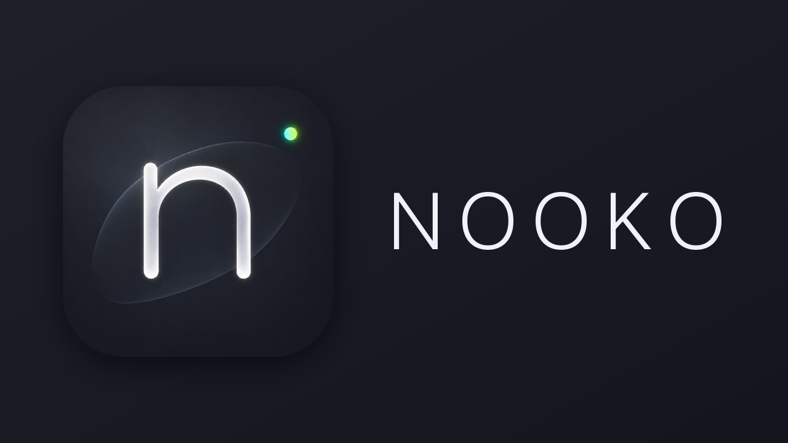

<p align="center">
  
</p>

<p align="center"><b>A calm, beautiful home screen for your Android TV and Google TV.</b><br>
Your apps, what to watch next, and a picture you love. Nothing else.</p>

<p align="center">
  <a href="https://github.com/depo23/Nooko-Launcher/releases/latest"><b>Download</b></a>
</p>

---

## Why Nooko

Most TV home screens are crowded with ads and suggestions you never asked for. Nooko gives you the opposite: a quiet screen that starts fast, looks like it belongs on a premium device, and shows only what you chose.

- **No ads. No account. No tracking.**
- **Light.** A tiny download that runs smoothly, even on small streaming sticks.
- **Yours.** Every part of the screen can be changed to fit your taste.

## What you get

**A home screen that looks great**
- Your apps on a soft glass shelf, with large banner icons that are easy to read from the couch.
- A clean, modern design with light and dark looks.
- A clock and the weather, if you want them.

**What to watch, right at hand**
- Trending films and series as big cards or a fullscreen showcase, with a synopsis, rating, cast and the streaming services that carry each title.
- Pick your country and your own services, and see only what you can really watch.
- **Continue Watching** from your apps, in one place.

**A picture you love**
- Your own photos, the Bing picture of the day, or beautiful landscapes, space and art from Reddit, by theme.
- A screensaver that shows your photos or the week's trending titles.

**Made for the remote**
- Move, pin, hide and reorder apps with a few presses.
- Give the buttons on your remote the jobs you want.
- Protect your layout with a PIN.
- Jump to your HDMI inputs and recent apps.

**Speaks your language**
English, Italiano, Français, Español, Português (Brasil), Türkçe and العربية.

## Make it yours

Open **Settings** from the top bar. You can change:

| | |
|---|---|
| **Look** | Light or dark, glass shelf, icon style, app size, wallpaper |
| **Apps** | Which apps show, in what order, pinned favourites, a second row of more apps |
| **Watch** | Cards or fullscreen, your country and streaming services |
| **Clock and weather** | Format, place, units |
| **Screensaver** | Your photos or trending titles, and when it starts |
| **Remote** | What each button does, and what Home opens |
| **Safety** | A PIN for the settings |

Everything you set can be saved to one file and restored on another TV.

## Get started

1. Download **Nooko-Launcher.apk** from the [latest release](https://github.com/depo23/Nooko-Launcher/releases/latest).
2. Install it on your TV. Any file app, or a computer on the same network, works.
3. Open Nooko Launcher and follow the short setup.

After that, Nooko tells you when a new version is ready and installs it for you.

### For film and series cards

Create a free account at [themoviedb.org](https://www.themoviedb.org), copy your API key, and paste it in **Settings → TMDB trending**. The key stays on your TV.

### Use Nooko as default Home

Some TVs open their own home screen when you press Home. To make Home open Nooko:

1. Open Nooko and follow the **Finish setup** page in Settings.
2. When asked, turn on **Nooko Launcher: Home button** in your TV's **Settings → Accessibility**.

**If your TV does not let you turn on Accessibility**, you can switch it on from a computer on the same network:

1. On the TV, turn on **ADB debugging** (Fire TV: **Settings → My Fire TV → Developer options**; Android TV and Google TV: tap **Build** seven times in **About**, then open **Developer options**). Note the TV's IP address.
2. On the computer, with [adb](https://developer.android.com/tools/releases/platform-tools) installed, run:

```
adb connect TV_IP:5555
adb shell pm grant dev.nooko.launcher android.permission.WRITE_SECURE_SETTINGS
adb shell settings put secure enabled_accessibility_services dev.nooko.launcher/dev.nooko.launcher.HomeOverride
adb shell settings put secure accessibility_enabled 1
```

3. Press Home on the remote.

If you already use other accessibility services, the third line replaces them. Use `tools/nooko-install.sh` instead: it keeps them, asks before every change, and can undo everything with `--undo`.

**Prefer an app?** A third-party tool such as Home-on-Fire can also send the Home button to Nooko.

## Privacy

Nooko goes online only for what you turn on: film and series information from TMDB, the weather, wallpapers from Bing or Reddit, and update checks. There are no ads, no analytics and no account. Your key and sign-ins stay on your TV and are saved in a backup only if you ask.

## Troubleshooting

- **Home opens the TV's own screen.** See *Use Nooko as default Home* above.
- **No film cards.** Add your TMDB key in **Settings → TMDB trending**, and check the TV is online.
- **Something else.** [Open an issue](https://github.com/depo23/Nooko-Launcher/issues/new/choose). Please tell us the TV model and Android version.

## Support Nooko

Nooko is free, with no ads. If it makes your TV nicer, you can [buy it a coffee on Ko-fi](https://ko-fi.com/nooko). On your TV, select the heart in the top bar and scan the code with your phone.

## Credits and licence

Nooko Launcher was inspired by [Plume](https://github.com/aradhyas8). Film and series data and images come from [TMDB](https://www.themoviedb.org); streaming availability data is provided by JustWatch through TMDB. Nooko is not endorsed or certified by TMDB.

Nooko Launcher is free software under the [GPL-3.0](LICENSE). See [NOTICE](NOTICE).

Contributions are welcome. See [CONTRIBUTING](CONTRIBUTING.md).
